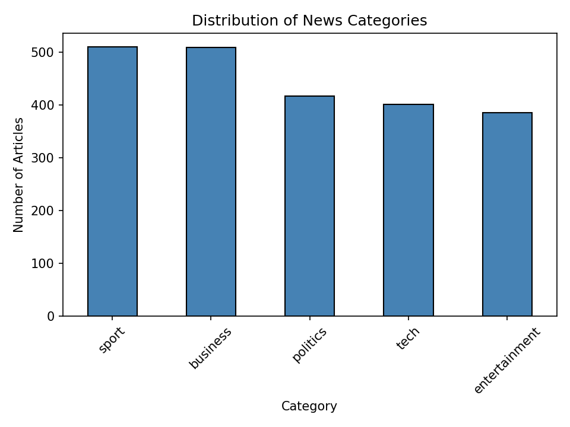
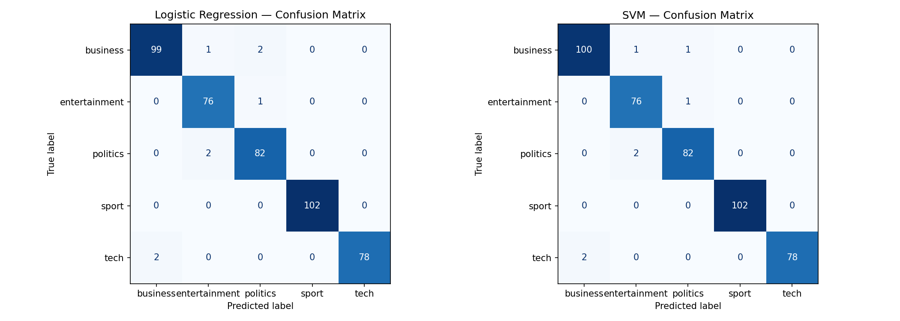

# BBC News Topic Classification (NLP)

A text classification pipeline that sorts BBC news articles into five topics: business, entertainment, politics, sport, and tech. Built for my Introduction to Deep Learning course at Pace University (Spring 2026).

## Dataset

2,225 BBC news articles, each labeled with one of five categories. The classes are fairly balanced:

| Category | Articles |
|---|---|
| Sport | 511 |
| Business | 510 |
| Politics | 417 |
| Tech | 401 |
| Entertainment | 386 |

The dataset was originally created by D. Greene and P. Cunningham (University College Dublin). Download `bbc-text.csv` here: [https://huggingface.co/datasets/SetFit/bbc-news]
## How It Works

1. **Cleaned the text with NLTK:** lowercased everything, removed punctuation and numbers, split the text into words, and dropped common filler words like "the" and "and"
2. **Turned the text into numbers with TF-IDF:** each article became a list of scores for the 5,000 most useful words. TF-IDF gives higher scores to words that are common in one article but rare across all of them, so topic words like "election" or "goal" stand out.
3. **Split the data 80/20,** stratified so each category kept the same share in both sets (1,780 training articles, 445 test articles)
4. **Trained two models:** Logistic Regression and a Linear SVM

## Results

| Model | Accuracy |
|---|---|
| Logistic Regression | 98.20% |
| Linear SVM | **98.43%** |

Both models did really well, with the SVM slightly ahead. Looking at the mistakes:

- **Sport was perfect.** 102 out of 102 on both models, since sports articles use very specific vocabulary.
- **Tech was mistaken for business twice** on both models, which makes sense since a lot of tech news is about companies and products.
- **Politics was mistaken for entertainment twice,** probably articles about public figures who cross both worlds.

## What I Learned

- **Simple models can be enough.** With clean data and good preprocessing, Logistic Regression scored over 98% without any deep learning.
- **The mistakes make sense.** The model only got confused between topics that actually overlap in real life, which shows it learned real patterns.
- **The dataset makes this easier than real-world text.** These articles are clean, balanced, and use pretty distinct vocabulary for each topic. Messier text would be harder.

## Limitations and Next Steps

TF-IDF only counts words. It doesn't understand meaning or word order, and articles that cover more than one topic can only get one label. Next steps would be:

- Try word embeddings (Word2Vec or GloVe) or a transformer model like BERT, which understand context
- Use cross-validation instead of a single train/test split for a more reliable score
- Tune hyperparameters like the SVM's C value

## How to Run

1. Download `bbc-text.csv` and put it in the same folder as the notebook
2. Install the libraries: `pip install pandas numpy scikit-learn nltk matplotlib seaborn`
3. Open `nlp.ipynb` in Jupyter or VS Code and run all cells (the first cell downloads the NLTK data it needs)

## Tools

Python, NLTK, scikit-learn, pandas, NumPy, Matplotlib, Seaborn, Jupyter

## License

The code in this repo is under the MIT License. The dataset belongs to its original creators and isn't covered by this license. See the Kaggle page for its terms.
